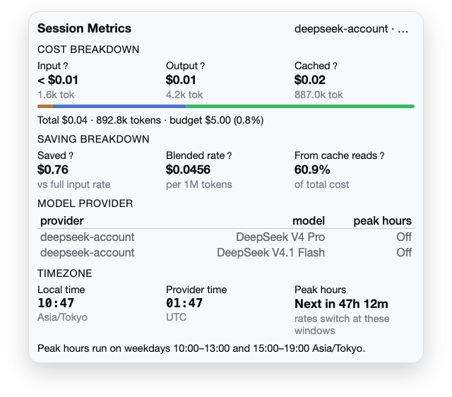
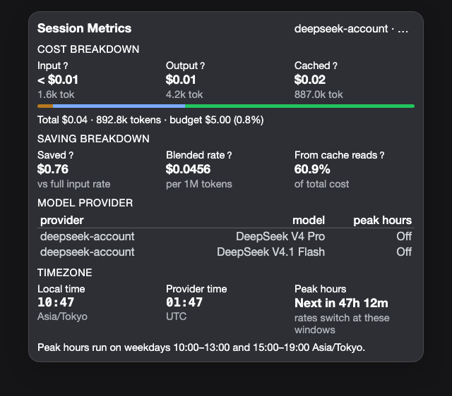

# dsh-session-metrics

Session **cost and billing** metrics for the DSH Web GUI — what this conversation cost, what the
cache saved, and whether the current hour is peak or off-peak. Built as a companion to the shipped
stats pills, never a duplicate of them.

## Why

The shipped stats pills report tokens and context, and stop short of money. That leaves three
questions unanswered, and the obvious answer to each is a lie:

**A model with no rate card is not free.** An unpriceable provider reads `unpriced` and shows its
tokens; a genuinely free model ships a card of zeros and reads a real `$0.00`. The two must not
render alike — `unpriced` means *no card*, and an unpriced pair is never rendered as a number.

**A newly integrated provider arrives silently.** DSH reports usage per provider and model; rates are
configuration. Integrate a provider before its rates are entered — the case that happened with
OpenRouter — and every figure for it is missing with nothing on the page saying why. The session
detail names the pair it observed with no card, and the tokens it used.

**Peak pricing is invisible until it is a surprise.** DeepSeek bills peak and off-peak at different
rates, in the provider's own timezone. Whether *right now* is peak is not something a user should
have to derive.

## Agent Skills

Installing the plugin registers the **`session-metrics`** skill, so an agent can explain the figures
and reconfigure the rates without reading the source. Ask it what a session cost, whether a model is
priced, or how to add a rate card for a provider it has seen.

## Quick Start

The plugin installs into your DSH **profile** by link — it is not published to npm, so the clone is
the source. Both routes end with a **restart**.

### Option A — the script

```bash
git clone https://github.com/mrdhira/dsh-session-metrics.git ~/.dsh/plugins/dsh-session-metrics
cd ~/.dsh/plugins/dsh-session-metrics
./install.sh                 # builds, registers in your profile, runs pnpm install
```

It accepts `--profile <dir>` to target a profile other than `~/.dsh/profiles/desktop`, `--check` to
report what would change without writing anything, and `--remove` to unregister.

### Option B — the manual steps

**1. Clone it somewhere stable** (this path becomes your install path):

```bash
git clone https://github.com/mrdhira/dsh-session-metrics.git ~/.dsh/plugins/dsh-session-metrics
cd ~/.dsh/plugins/dsh-session-metrics
```

**2. Build it.** `pnpm install` runs the `prepare` script, which builds `lib/**` — the part DSH
actually loads. It is generated; never hand-edit it.

```bash
pnpm install
```

**3. Register it with your profile** — the dependency and the bundle name, with an absolute path:

```json
{
  "dependencies": {
    "dsh-session-metrics": "link:/Users/<you>/.dsh/plugins/dsh-session-metrics"
  },
  "dsh": {
    "profile": {
      "bundles": [
        "dsh-session-metrics"
      ]
    }
  }
}
```

**4. Install the link, then restart DSH:**

```bash
cd ~/.dsh/profiles/desktop && pnpm install
```

Nothing needs adding to `cordis.patch.yml`: the bundle declares its own Loader row.

> **Restart, don't reload.** The host half loads once per app process, so a host-side change needs a
> full quit and reopen (`⌘Q`, then reopen). A page reload does not pick it up. A client-side (UI)
> change needs the bundle toggled in the plugin manager.

### Verify it is really working

A strip should appear below the composer with `cost`, `saved` and a peak indicator. If it does not:

- `lib/v1/index.js` exists — if not, `pnpm install` did not finish building;
- the profile's `package.json` names `dsh-session-metrics` in **both** `dependencies` and
  `dsh.profile.bundles`;
- DSH was **restarted** after installing.

An `unpriced` chip means a working install with no matching rate card — not a failure. See
[Configure](#configure).

### Configure

**A fresh install needs no configuration.** Rate cards ship for `deepseek-account`,
`deepseek-official`, `netra-runtime` and `openrouter`, so the cost chip works immediately. OpenRouter
ships **only the models its own catalog marks free** (the `:free` suffix and the free-models router)
at zero rates; its paid models deliberately carry no card, because DSH reports no prices for them and
a fabricated rate is worse than a named gap.

Rates are edited in the GUI: **Plugins sidebar → `dsh-session-metrics`**. The same table can be set
in your profile's `cordis.patch.yml`:

```yaml
- id: session-metrics
  name: dsh-session-metrics
  config:
    display: { currency: USD, primaryProvider: deepseek-account }
    budget: { sessionUsd: 5, warnAt: 0.75 }
    providers:
      - id: my-router
        models:
          - model: some/model
            rates: { flat: { cacheHit: 0.01, cacheMiss: 0.1, output: 0.25 } }
        billing: { windows: [] }      # no peak concept
```

Rates are USD per 1M tokens. A model takes **either** a `flat` row **or** a `peak` row with
`offPeak`. A provider with no `billing.windows` is flat and shows no peak chip.

> **A `providers:` list in your patch replaces the shipped cards** rather than adding to them. Pin your
> own providers and the OpenRouter free cards stop shipping with them — add a card for each pair you
> need, or let **Seen, unpriced** name the ones you missed.

| Setting | Default | What it does |
|---|---|---|
| `display.currency` | `USD` | `USD` or `CNY` |
| `display.primaryProvider` | — | hides the provider chip when the session uses this provider |
| `display.chips` | all | which chips to show, and in what order: `peak`, `time`, `cost`, `saved`, `provider`, `budget` |
| `budget.sessionUsd` | off | per-session ceiling; omit to disable |
| `budget.warnAt` | `0.75` | fraction of the budget at which the strip warns |

The full rate-card format, the shipped cards and the reasoning behind them are in
[`docs/pricing.md`](docs/pricing.md).

## How it Works

Costs are derived from the Host's own `tokenUsage` projection — the same source the stats pills read
— so this plugin adds interpretation, not a second ledger. Cache savings compare each cache-hit token
against the rate that would have been paid on a miss, per the card in effect. Peak and off-peak
windows resolve in the provider's own timezone, holidays included, and the countdown is computed once
a minute while the detail view is open rather than on every render.

Two surfaces, one projection:

- **the strip**, below the composer: cost, cache savings, the peak state with your local time, the
  provider when it is not your configured primary, and budget progress;
- **the detail**, on click: the cost breakdown (cache-hit / miss / write / output), cache savings and
  blended rate, the rate window with a countdown, cost per step, cost per model when a session
  switched models, and the projections each figure came from.

The plugin deliberately does **not** render session token totals, cache-hit rate, context percentage,
turns, steps or tok/s — the shipped pills own those. [`docs/data-sources.md`](docs/data-sources.md)
records which projection feeds which figure, which is what keeps the two from drifting back into
duplication.

### Requirements

- **DSH** with the Web GUI, and a profile you can edit (`~/.dsh/profiles/<profile>/`).
- **Node.js 22+** and **pnpm** to build from source. The built artifact needs nothing extra at
  runtime.

### Development

```bash
pnpm install                  # deps + build (prepare)
pnpm run build                # rebuild lib/**
pnpm test                     # 111 tests: 105 pass, 6 skipped without a session log
pnpm run typecheck            # three projects: host, browser half, tests
pnpm run test:fast            # host logic only — the quick loop
pnpm run test:dom             # the UI half under jsdom
DSH_SESSION_LOG=<path>.jsonl.zstd pnpm run test:replay   # replays a real session
```

```
src/host/*.ts         host half: config schema, projection, ledger, pricing  -> lib/v1/index.js
src/client/index.cts  browser half: strip, detail panel, pricing page        -> lib/v1/client.js
types/dsh.d.ts        the DSH surfaces this plugin uses (the app ships no .d.ts)
build.mjs             esbuild: ESM host half, CJS browser half + loader handshake
docs/                 authoring, data-sources and pricing notes
```

The six skipped tests are the replay ones; they need `DSH_SESSION_LOG` pointing at a real recorded
session. With one, the suite is **111/111**.

`lib/**` is generated and never hand-edited. **Build before you test:** the tests import the built
artifacts, so a run against a stale build is green and wrong — `pnpm test` builds via `pretest`.

### Testing and Validations

111 tests across twelve files. The host half is covered table-driven — every case names the rule it
pins, so a failure reads as a sentence — and the browser half mounts the real bundle under jsdom.

What the suite proves beyond "the code runs":

- **the freshness gate** (`build.test.ts`): every source module has an artifact, no artifact predates
  its source, and the entrypoints `main`/`exports` name actually exist. This exists because five test
  files once validated stale pre-port `lib/*.js` that were no longer shipped — green, and wrong.
- **non-vacuity**: a new test is proven by mutation probe, not by passing. Deleting the badge's
  subject gate fails 2/14; reverting the calendar default fails one named test.
- **memory discipline**: two defects once drove a machine to ~170 GB RSS, so the suite runs through
  `scripts/guard.mjs`, which watches the whole process tree and kills it past the cap (exit **124** —
  bisect, never raise it). A failing assertion must never take a DOM node as its `actual` value:
  compare primitives (`assert.ok(node === null)`), because inspecting a React node walks its fiber
  tree and allocates without bound.

Measured on Node v24: host tests peak ~70 MB, the DOM file ~180 MB, and the full suite with a real-log
replay **277 MB under a 1 GB limit**.

### Contributing

One author: **Dhira Wigata**. Every commit is authored and committed by him, and CI re-checks the
whole history for a single identity and for machine-attribution trailers — so `--no-verify` locally
does not get a commit past CI. `Signed-off-by:` is fine. See [`AGENTS.md`](AGENTS.md) for the gates a
change must pass: build, typecheck across three projects, and the suite.

Issues and pull requests are welcome.

## What it looks like

The strip as it docks under the composer, at the width the app actually gives it: DSH's own
`computeColumns()` resolves a 1440×900 window to a 280px sidebar and a **1160px** centre column, and
that is the canvas below. Every colour is one of the app's theme tokens.

| light | dark |
|---|---|
|  |  |

The detail popover behind the trigger — cost breakdown, saving breakdown, per-model rows, and the peak
window with its countdown.

| light | dark |
|---|---|
|  |  |

Both come from `scripts/capture-panel.mts`, which renders the **real** bundle through
`test/harness.ts` — the same path the DOM tests take — injects the **real** stylesheet the bundle
itself ships, and resolves the `--dsw-*` tokens out of the installed `app.asar`. Nothing is mocked and
no colour is hand-picked. Run it with:

```bash
node ~/.dsh/scripts/guard/guard.mjs --limit-mb 2560 -- \
  node --max-old-space-size=384 scripts/capture-panel.mts
```

One honest gap: the popover is captured **standalone**, centred by a layout wrapper, rather than
anchored under the strip. Its `left`/`bottom` come from a live `getBoundingClientRect()` of the docked
trigger, and the headless renderer has no layout engine to produce one — so its content, width and
styles are real, and only the frame around it is not.

### There is no flow to draw

This is a metrics panel, not a pipeline: the strip and the popover are two projections of one
already-complete figure. Costs are derived from the Host's own `tokenUsage` projection, savings compare
each cache-hit token against the miss rate on the same card, and the peak state is a clock read against
the provider's window — all computed in the browser half on render. No queue, no stages, no hand-off,
and no ordering a diagram would add information to. A flow diagram here would be decoration, so there
is none; the data path is the table in [`docs/data-sources.md`](docs/data-sources.md) instead.

## LICENSE

[MIT](LICENSE) © Dhira Wigata